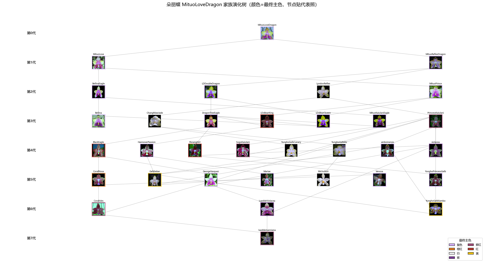
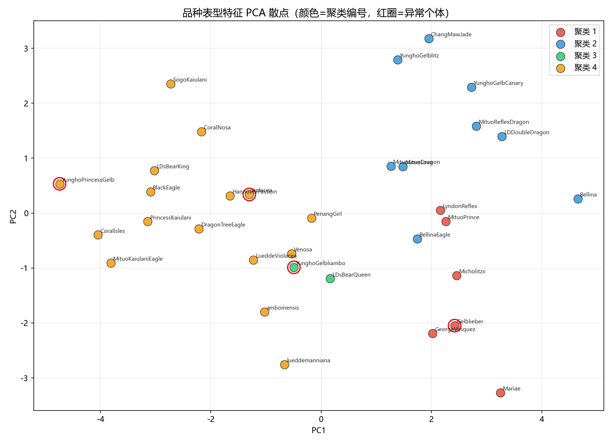
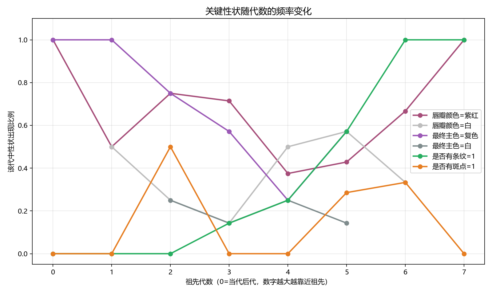

# Orchid Genetics Analysis

朵丽蝶（Doritaenopsis）表型遗传规律分析，来自大数据采集与处理课程项目。

项目围绕 33 个品种的单谱系祖先集，对花色、唇瓣、条纹、代际关系和祖先贡献进行统计与建模。

## 分析内容

- 数据加载、字段清洗与合并
- 代际性状频率统计
- 亲本-子代性状传递概率
- 数值特征亲子相似度
- 性状关联规则挖掘
- 层次聚类
- 孤立森林异常检测
- 奠基者影响力评分
- 决策树分类、调参和交叉验证

## 主要结果图







更多图表位于 `docs/images/`，完整统计结果位于 `results/`。

## 数据

```text
data/朵丽蝶_特征总表.csv   # 38 项表型特征
data/族谱.xlsx              # 33 个品种的族谱关系
```

数据来源：

- 品种族谱：RHS International Orchid Register
- 品种照片与特征：公开育种目录、兰花展会资料，经程序提取后人工核验

原始品种图片压缩包未包含在仓库中，原因是体积较大且部分素材存在版权限制。分析代码和已经生成的统计结果可以独立查看。

## 运行

```powershell
python -m venv .venv
.\.venv\Scripts\Activate.ps1
pip install -r requirements.txt
python src/遗传分析.py --features data\朵丽蝶_特征总表.csv --lineage data\族谱.xlsx
```

主要入口：

- `src/遗传分析.py`：完整分析流程
- `src/step0.py`：数据检查
- `src/step1_preprocess.py`：预处理
- `src/step2_extract.py` / `step2new.py`：特征处理实验

## 项目结构

```text
orchid-genetics-analysis/
├─ src/
├─ data/
├─ results/
├─ docs/images/
├─ requirements.txt
└─ README.md
```

## 说明

- 样本量为 33，属于单谱系非随机采样，统计概率不能外推为朵丽蝶总体规律。
- 品种照片受光照和白平衡影响，跨品种颜色绝对值对比较为敏感。
- 决策树和交叉验证结果用于课程分析，不构成育种或商业决策依据。
